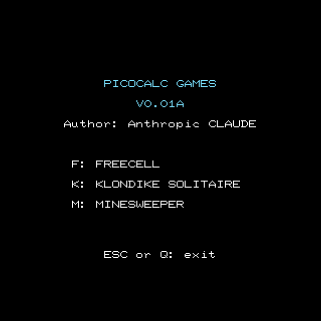
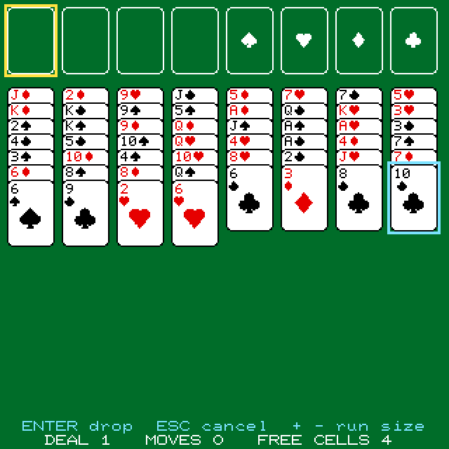
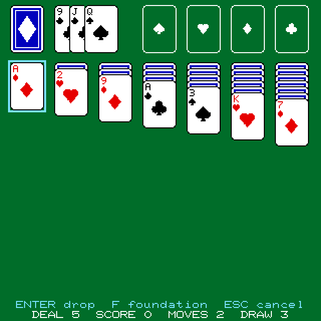
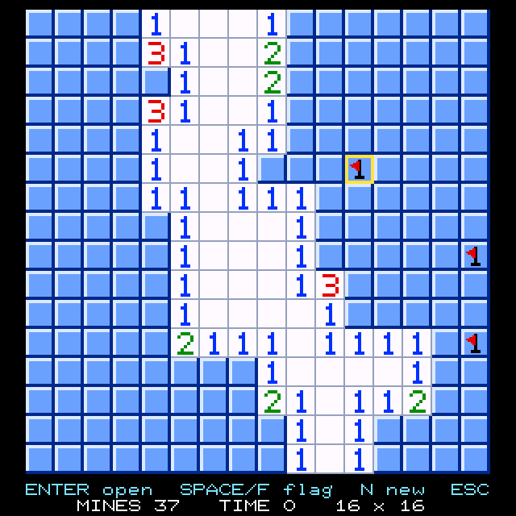
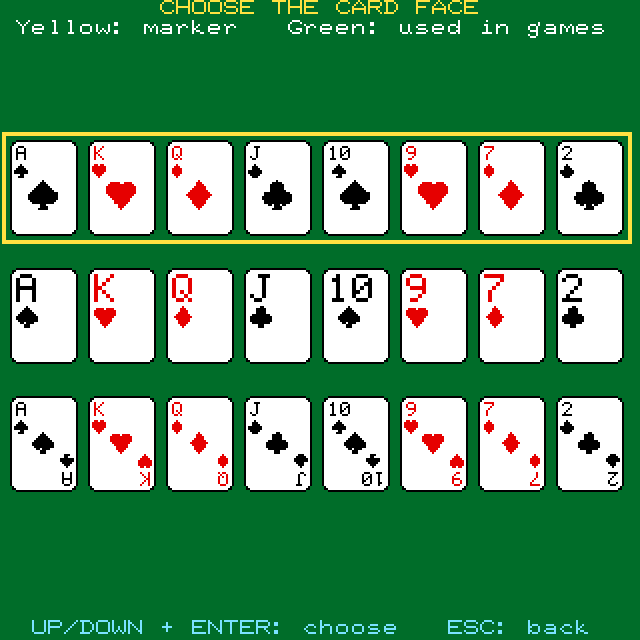

# PicoCalc Games

Author: Anthropic Claude, with a tiny bit of prompting from Thomas Dzubin
License: MIT    Version: see `VERSION` in [`games_const.h`](games_const.h)

Three games for the ClockworkPi **PicoCalc** (Raspberry Pi Pico or Pico 2), on
its 320 x 320 screen: **FreeCell**, **Klondike Solitaire** and **Minesweeper**.
The cards are 34 x 48 pixels, close to the 5:7 shape of a real card, with
rounded corners, and a card chooser (the `C` key in FreeCell and Klondike) picks
which of three face layouts the card games use. A win is celebrated with a
fanfare and a show.

No SD card is needed. The program is plain C on the Pico SDK; a desktop (SDL2)
build for Windows and Linux is set up too, but it has not been built or tested
yet.

## Screenshots

<table>
  <tr>
    <td><br>The title screen</td>
    <td><br>FreeCell, deal 1, with a card picked up</td>
    <td><br>Klondike Solitaire, drawing 3, an ace picked up</td>
  </tr>
  <tr>
    <td><br>Minesweeper, the 16 x 16 board</td>
    <td><br>The card chooser (the <code>C</code> key in the card games)</td>
    <td></td>
  </tr>
</table>

These are the program's own screens, drawn by the same code as on the
PicoCalc and saved from a PC build with the PicoCalc's 8 x 10 font; they are not
photographs of the device.

## Download and flash

Each release has two firmware files: **`games-RP2350.uf2`** for the Pico 2 and
**`games-RP2040.uf2`** for the Pico. Hold BOOTSEL while powering the PicoCalc on,
or press `~` (SHIFT + backtick) in a running program. A drive named `RP2350`
(or `RPI-RP2` on a Pico) appears; copy the matching `.uf2` file onto it. The
program starts at once, on the title screen.

## Title screen

Press `F` for FreeCell, `K` for Klondike Solitaire or `M` for Minesweeper. `ESC`
or `Q` leaves for the PicoCalc UF2 Loader menu (it asks the loader for its menu
through the watchdog scratch registers; with no loader installed the program just
restarts, and on a PC it closes).

## FreeCell

The 4 free cells and the 4 foundations (spades, hearts, diamonds, clubs) are the
top row and the 8 columns are below. Cards that are covered show a slim index
(rank and suit side by side). A yellow frame is the cursor; a picked-up card or
run has a cyan frame.

- Every deal has a number from 1 to 32000, the same shuffle as the classic
  Windows game (deal 1 starts with JD 2D 9H JC 5D 7H 7C 5H across the top).
  Type a number to replay a deal, or press ENTER alone for a random one.
- Moving a run of cards is allowed as far as the free cells and empty columns
  permit (the usual rule). On a column that is not empty, the cards that fit
  are found for you; for an empty column use `+` and `-` after picking up to
  choose how many cards.
- Cards that are safe (nothing of the other colour can still need them) go to
  the foundations by themselves. `U` undoes a move together with the automatic
  moves that followed it, back to the start of the deal.
- A card or run that moves flies to its place, and so does each card that goes
  home by itself. `S` changes the speed (off, fast, normal, slow); it starts on
  fast and is not kept between runs.
- Two refused drops in a row put the picked-up card back, in case another card was
  meant.

## Klondike Solitaire

The stock and the waste are at the top left, the 4 foundations (spades, hearts,
diamonds, clubs) at the top right, and the 7 columns are below. Face-down cards
show a thin strip of their back; face-up covered cards show the slim index.

- Before the deal you choose to draw 1 card or 3 at a time (`T` on the screen
  that asks for the deal number) and may type a deal number from 1 to 32000
  (ENTER alone gives a random one). The same number is always the same deal; the
  shuffle is this program's own, so a number does not match any other program's.
- ENTER on the stock draws (with the stock empty it turns the waste over
  again). With 3 cards drawn, the last three cards of the waste are fanned out
  and only the top one can be played.
- ENTER on a card picks it up (the face-up card at the foot of a column, the
  top of the waste, or the top of a foundation) and ENTER again drops it. When you
  drop on a column, the card of the face-up run that fits there is found for
  you, and the cards on it move along. Only a king goes to an empty column. A
  face-down card that is uncovered turns over by itself.
- `F` sends the card under the cursor (or the one you have picked up) straight
  to its foundation.
- Standard scoring as in the Windows game, without the clock: waste to a column
  5, to a foundation 10, column to a foundation 10, a card turned up 5, a card
  taken back from a foundation minus 15, and turning the waste over again minus
  100 when drawing 1, or minus 20 after the first two times when drawing 3. The
  score never goes below 0.
- `U` undoes any move, one at a time, with the score, back to the start of the
  deal.
- Once the stock and the waste are empty and no card in a column is face down,
  the game finishes itself: the cards fly to the foundations one after the other.

## Minesweeper

A menu offers the three classic boards (Beginner 9 x 9 with 10 mines,
Intermediate 16 x 16 with 40, Expert 30 x 16 with 99) and a custom board: you
type the width (8 to 30), the height (8 to 24) and the number of mines. The
squares are made as big as the screen allows, from 33 pixels on the beginner
board down to 10 on the expert one.

- A yellow frame is the cursor. ENTER opens a square. On an open number that has
  as many flags round it as the number, ENTER opens all the squares round it that
  are not flagged (the "chord"). A flag protects a square from being opened.
- SPACE or F steps a square through a flag, a question mark and no mark. The
  counter shows the mines minus the flags.
- The timer starts with the first square opened. The best time for each classic
  board is shown in the menu; it is kept until the PicoCalc is switched off.
- The mines are laid when the board is made, so the first square you open can be
  a mine. When you lose, every other mine is shown, the one you opened is on
  yellow, and a flag where there is no mine is crossed out. When you win, the
  mines left are flagged.
- `N` makes a new board of the same size, `R` plays the same board again.

## Winning

A win is celebrated with a short fanfare. In FreeCell and Klondike all 52 cards
fall from the foundations, kings first, and bounce across the screen leaving
their trails, which takes about twenty seconds; in Minesweeper the board flashes
green and yellow. Any key skips the show. Then the final screen comes back with
`YOU WIN!`. `F4` ends a game as a win at once, to see the show without playing a
game through.

## Controls

| Key | Where | Does |
|---|---|---|
| `F`, `K`, `M` | title screen | plays FreeCell, Klondike Solitaire, Minesweeper |
| `ESC` or `Q` | title screen | leaves for the PicoCalc UF2 Loader menu |
| arrow keys | FreeCell, Klondike, Minesweeper | move the cursor; held down, they repeat |
| `ENTER` or `SPACE` | FreeCell, Klondike | pick up the card or run under the cursor; again on another spot to drop it (on the same spot to put it back). In Klondike on the stock: draw |
| `1` to `8`, `A`, `F` | FreeCell | jump the cursor to a column, to the first free cell that is empty, to the foundations |
| `1` to `7`, `D`, `W` | Klondike | jump the cursor to a column, the stock, the waste |
| `F` | Klondike | send the card under the cursor (or picked up) to its foundation |
| `+` and `-` | FreeCell | one more or fewer card in the run picked up |
| `T` | deal number screen | Klondike: draw 1 or 3 cards |
| `U`, `R`, `N` | FreeCell, Klondike | undo; the same deal again; another deal |
| `S` | FreeCell, Klondike | animation speed: off, fast, normal, slow |
| `C` | FreeCell, Klondike | opens the card chooser |
| `UP`, `DOWN`, `ENTER` | card chooser | move the marker over the three rows (the faces) and choose the one the games use: a green frame shows the chosen row, yellow the marker. Lasts until the PicoCalc is switched off |
| `ENTER` | Minesweeper | open a square, or chord on an open number |
| `SPACE` or `F` | Minesweeper | flag, question mark, none |
| `N`, `R` | Minesweeper | a new board of the same size; the same board again |
| `F4` | all three games | ends the game as a win at once, with the show (Minesweeper records no best time) |
| `ESC` | all three games | drops what is picked up; otherwise back to the title screen (Minesweeper: to its menu first). In the card chooser, back to the game |
| `~` (SHIFT + backtick) | everywhere | reboots into BOOTSEL (USB drive) mode |

## Files

```
games.c, games_const.h        main, the title screen, and every constant of the program
freecell.c, freecell.h        the rules of FreeCell (no screen; tested on a PC)
freecell_play.c               the FreeCell screen and keys
freecell_const.h, freecell_play_const.h
                              constants of the rules; of the screen, keys and texts
klondike.c, klondike.h        the rules of Klondike (no screen; tested on a PC)
klondike_play.c               the Klondike screen and keys
klondike_const.h, klondike_play_const.h
                              constants of the rules; of the screen, keys and texts
minesweeper.c, minesweeper.h  the rules of Minesweeper (no screen; tested on a PC)
minesweeper_play.c            the Minesweeper menu, screen and keys
minesweeper_const.h, minesweeper_play_const.h
                              constants of the rules; of the screen, keys and texts
mine_cells.c, mine_cells.h, mine_cells_const.h
                              the squares of the Minesweeper board, drawn into a pixel buffer
cards.c, cards.h, cards_const.h
                              the playing cards, drawn into a pixel buffer (no hardware calls)
cardfly.c, cardfly.h          a card or a run of cards flying across the screen
victory.c, victory.h, victory_const.h
                              the fanfare and the show when the player wins
chooser.c, chooser.h          the screen for choosing the look of the cards
settings.c, settings.h        the choices the games share (kept until switch-off)
ui.c, ui.h                    text rows and the keyboard, shared by the screens
platform.h                    the whole interface to the machine: clock, sleep, BOOTSEL, exit to the loader
platform_pico.c, platform_pico_const.h
                              platform.h on the Pico SDK (PicoCalc firmware)
tests/                        host tests that run on a PC: sh tests/run_tests.sh
CMakeLists.txt                builds the firmware, reusing picocalc-text-starter-main/drivers/*
desktop/                      Desktop (SDL2) build, Windows and Linux: CMakeLists.txt, shim_desktop.cmake
                              (shared build logic), the small shim that stands in for the PicoCalc
                              drivers, and platform_desktop.c
pico_sdk_import.cmake         standard Pico SDK locator
picocalc-text-starter-main/   vendored driver layer (see License; do not edit)
LICENSE, CHANGELOG.md         MIT licence; version history
```

## Building

### With the Raspberry Pi Pico VS Code extension (easiest)

Open this folder, pick the board (Pico or Pico 2) and press Compile.

### From a terminal

Set `PICO_SDK_PATH` to your Pico SDK checkout (SDK 2.3.1), then:

```bash
cmake -B build-rp2350 -G Ninja -DPICO_BOARD=pico2
ninja -C build-rp2350
```

For a Pico use `-DPICO_BOARD=pico` (and another build folder). The result is
**`games-RP2350.uf2`** (or **`games-RP2040.uf2`**), also copied to this folder.
On Windows put the Arm toolchain ahead of MSYS2's compiler in `PATH`.

### The tests

The rules of all three games are checked on a PC, with no hardware:

```bash
sh tests/run_tests.sh
```

It needs a C compiler (`gcc`) on the path.

### On Windows (not yet built or tested)

A small SDL2 layer in [`desktop/`](desktop/) stands in for the PicoCalc's LCD,
keyboard and audio drivers. From an MSYS2 UCRT64 shell with SDL2 installed:

```bash
cmake -S desktop -B build-windows -G Ninja
ninja -C build-windows
```

The result is **`games-Windows.exe`** in this folder (SDL2 is linked
statically, so it is a single file). The PC keyboard takes the place of the
PicoCalc's, and `~` closes the program.

### Linux (not yet built or tested)

With the SDL2 development package installed (for example `libsdl2-dev`):

```bash
cmake -S desktop -B build-linux
cmake --build build-linux
```

The result is **`games-Linux`** plus **`libSDL2-2.0.so.0`** in this folder.
Keep the two files together; the executable finds the library beside itself.

## License

This project's own code and docs (`games.c`, the build files, this
`README.md`) are released under the MIT License, see [`LICENSE`](LICENSE).
Copyright © 2026 Thomas Dzubin.

### Third-party

`picocalc-text-starter-main/` is a vendored copy of
[**picocalc-text-starter**](https://github.com/BlairLeduc/picocalc-text-starter)
by Blair Leduc (the LCD, audio and south-bridge keyboard drivers). It is **not**
relicensed by this project: it keeps its own MIT license at
[`picocalc-text-starter-main/LICENSE`](picocalc-text-starter-main/LICENSE),
Copyright © 2025 Blair Leduc. The Raspberry Pi Pico SDK it builds against is
licensed separately by Raspberry Pi Ltd. (BSD-3-Clause).

The vendored copy is Blair Leduc's `picocalc-text-starter` as it was on 2026-10-18
(commit `85a002e`, "Upgrade to SDK 2.3.1"), with **four small local fixes** that
are not in his repository yet:

1. In `picocalc-text-starter-main/drivers/fat32.c`, `fat32_write()` no longer walks
   the cluster chain, allocating a cluster at a cluster-aligned end of file, before
   it allocates the clusters the write needs. That walk could leave a cluster
   unreachable (a leak). A write of zero bytes returns at once.
2. In the same file, `fat32_dir_read()` copies the last part of a long file name of
   248 to 255 characters as far as it fits; upstream drops that part.
3. In `picocalc-text-starter-main/drivers/sdcard.c`, a command is not sent to a card
   that is still busy after the 0.5 s wait.
4. In `picocalc-text-starter-main/drivers/lcd.c`, `lcd_putstr()` cuts a string off at
   the right edge of the display, because the line buffer holds exactly one row of
   text.

Earlier versions of this copy carried other local changes, and those are now in
the upstream code: the search-hint fix in `get_next_free_cluster()`
([#30](https://github.com/BlairLeduc/picocalc-text-starter/pull/30)), the
deleted-entry fixes in `fat32_dir_read()` and `link_entry()`
([#32](https://github.com/BlairLeduc/picocalc-text-starter/pull/32)), the timed
busy-card wait in `sdcard.c`
([#33](https://github.com/BlairLeduc/picocalc-text-starter/pull/33)) and
`lcd_unblit()` ([#31](https://github.com/BlairLeduc/picocalc-text-starter/pull/31)).
`audio.pio` is exactly as downloaded: it now accepts 20 to 20000 Hz
([#29](https://github.com/BlairLeduc/picocalc-text-starter/pull/29)), where it used
to accept only 100 to 2000 Hz. Everything else is exactly as downloaded.
